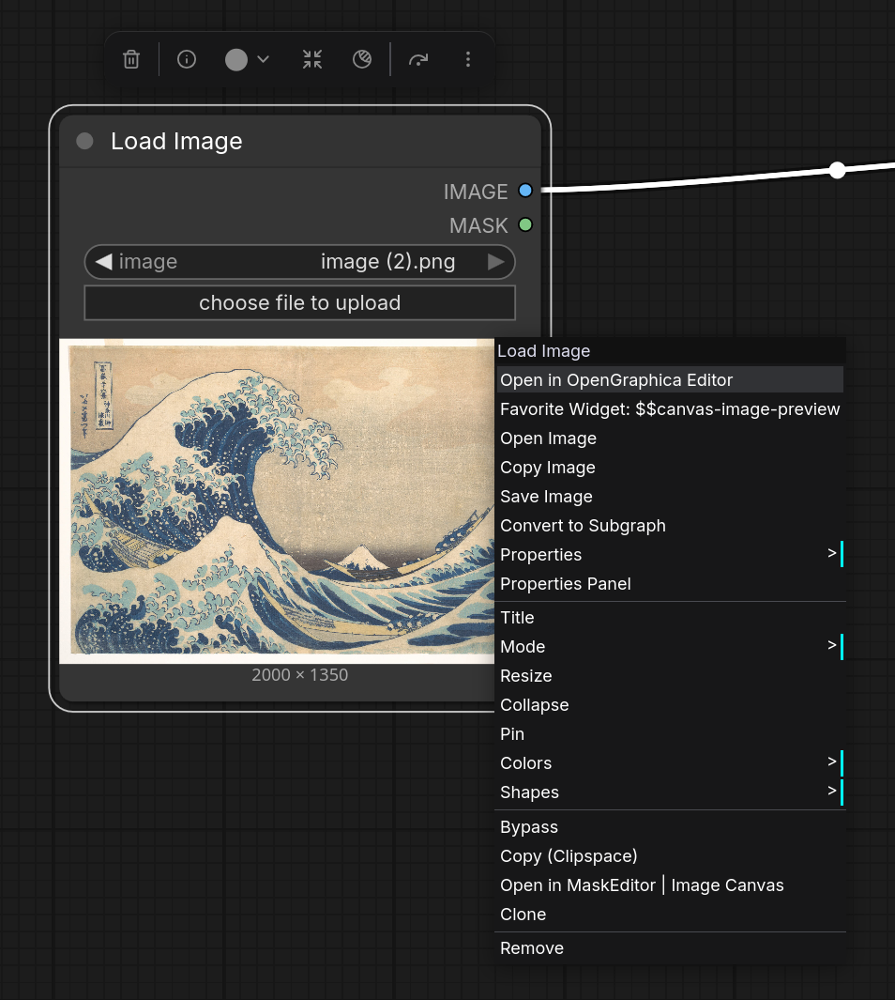
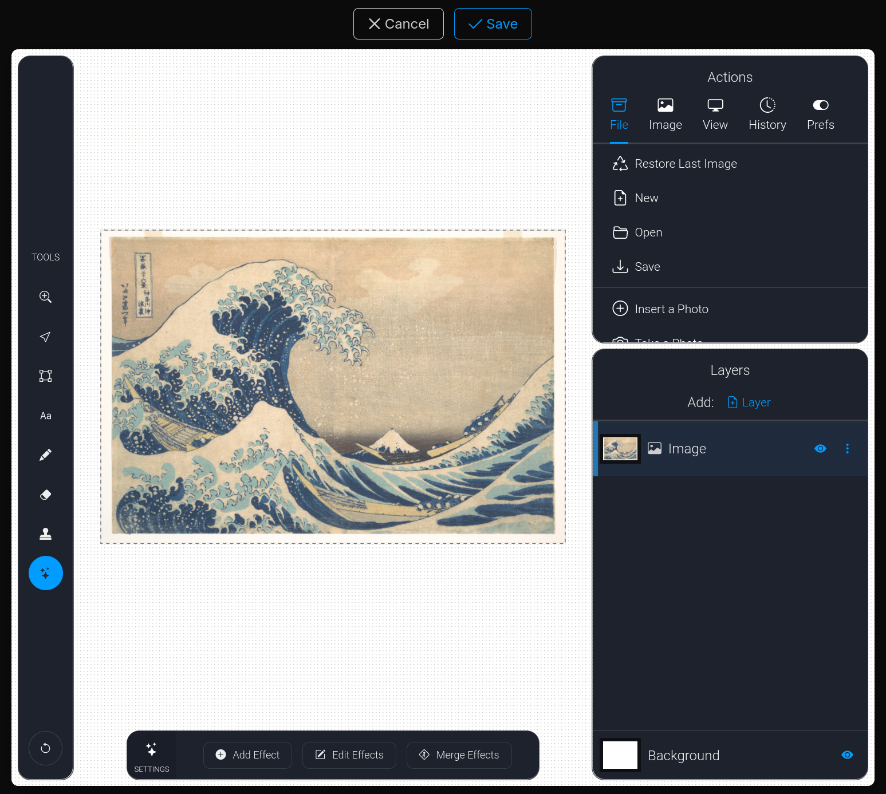

# ComfyUI-OpenGraphica

Edit images in the OpenGraphica image editor directly within ComfyUI.

## Installation

### Via GIT

You must have [Node.js](https://nodejs.org/en) installed on your computer.

Starting inside of your ComfyUI installation folder:

```sh
cd custom_nodes
git clone https://github.com/opengraphica/ComfyUI-OpenGraphica.git
cd ComfyUI-OpenGraphica
npm install
```

## Usage

This extension adds an `Open in OpenGraphica editor` option when you right-click on any node that has an image or mask output.



